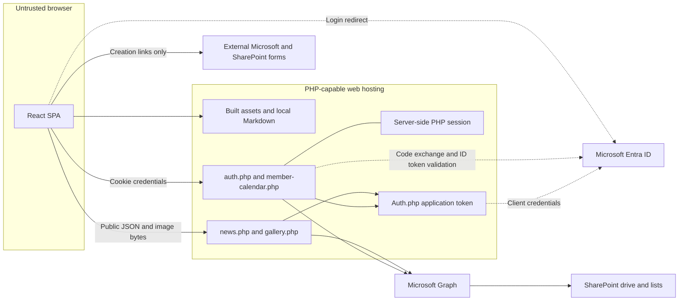
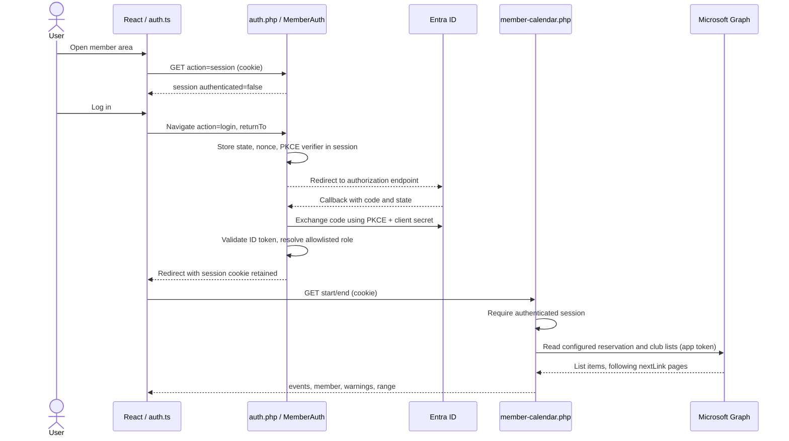
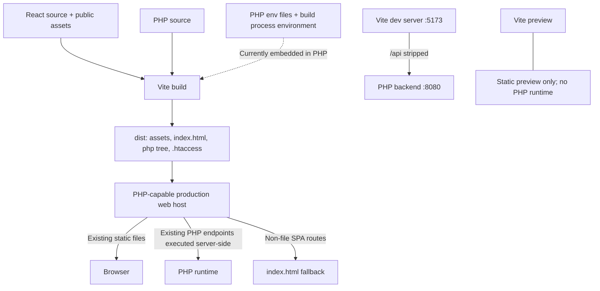

# Architecture

[Documentation index](README.md) · [Offline visual overview](diagrams/architecture.html)

## System context and trust boundaries

The browser never receives the backend application's Graph credential. `src/lib/graph.ts` calls PHP, despite its name. App-only Graph permissions authorize PHP to access SharePoint independently of the signed-in user; **PHP session/capability checks are the member-data trust boundary**. Entra authentication alone does not grant membership. The allowlists in `MemberAuth.php` assign member/admin roles.

The creation forms are external dependencies. Their processing, permissions and any automation are outside this repository. Do not infer a website creation API or a particular Power Automate flow.

## Source ownership

| Layer | Files and responsibility |
| --- | --- |
| Bootstrap/layout | `src/main.jsx`, `src/App.jsx`, Header/Footer, `src/theme.js`, CSS |
| Public content | News/NewsFeed/Gallery components and `src/lib/graph.ts` |
| Boats/about/contact | Boats reads `public/boats-*.md`; App reads `public/onas.md` and `public/vedeni.md` |
| Member UI | `MemberArea.jsx` handles pages/forms; `MemberCalendar.jsx` handles calendar/detail/actions |
| Browser session | `src/lib/auth.ts`: provider, session cache, login/logout navigation |
| Public endpoints | `php/endpoints/news.php`, `gallery.php`: dispatch and HTTP caching |
| Public domain logic | `php/modules/News.php`, `Gallery.php`: SharePoint folders, normalization, caches |
| Identity and transport | `php/core/MemberAuth.php`, `Auth.php`, `GraphAPI.php`, `Config.php` |
| Calendar | `php/endpoints/member-calendar.php`: procedural request handling, two source mappings, pagination and Graph mutations |
| Legacy code | `php/modules/Router.php` is not the dispatcher used by the four current endpoint files |
| Build/hosting | `vite.config.js`, `public/.htaccess`, Dockerfile and Compose |

### Routes

| Route | Behavior |
| --- | --- |
| `/` | About/contact Markdown, news feed, gallery |
| `/novinky` | News list/detail; selection actually uses `?year=...&article=...` |
| `/novinky/:year?`, `/novinky/:year/:article` | Declared aliases; do not assume News consumes path parameters |
| `/nase-lode` | Local boat content |
| `/clenska-sekce` | Session-gated calendar and external form buttons |
| `/clenska-sekce/cenik` | Session-gated UI for bundled price-list Markdown |
| `/clenska-sekce/pravidla-pujcovani` | Session-gated UI for bundled rental rules |

The rules, price list and payment QR are compiled frontend assets. UI gating is not confidential file delivery; do not store sensitive member data in these assets.

## Member login and calendar reads

OIDC uses `openid profile email`; this is separate from Graph's client-credentials `/.default` scope. Session cookies use HttpOnly, SameSite=Lax and Secure when PHP detects HTTPS. An externally terminated TLS connection must be represented correctly to PHP. Role capabilities and action-specific checks are detailed in [API](api.md).

`auth.ts` caches session state in module memory without expiry; its refresh function can return that cached value. Server-side session checks remain mandatory. Existing PHP sessions can retain stored roles/capabilities after allowlist changes; see [Operations](operations.md#security-and-correctness-limitations).

## Public content and caching

Public endpoint → `News`/`Gallery` → `GraphAPI` → `Auth` → Graph → SharePoint default drive. Public enumeration uses configured folder constants in `Config.php`; listing is not a direct browser-to-SharePoint request.

Caching exists at several layers: browser component caches, PHP temporary files, encrypted app-token cache, site-ID cache and public HTTP cache headers/conditional requests. Constants include token 3000 seconds, site 86400, gallery/news 600. HTTP policies vary by response: year lists 3600 seconds, news articles 1800, image bytes 86400. Read the actual endpoint/module before adjusting freshness; a single constant does not control all caches. Session and member responses must not be cached as public content by the hosting layer.

## Build and deployment topology

The env input arrow is a current **security hazard**, not a recommended secret-management design. See [Deployment](../DEPLOYMENT_README.md). The repository does not establish production host provisioning, DNS, secret rotation or external form automation. Compose is a backend development aid; it does not build the SPA. In production, route PHP endpoints before the SPA fallback so configuration errors do not return HTML to JSON clients.

## Extending the system

- Add a route in App, a focused component and a typed proxy helper; document the route and its data source.
- Keep credentials/Graph writes server-side. Add authorization to the endpoint, not only button visibility.
- If adding a third calendar source, do not assume the historical generic registry is implemented. Update source mapping, normalization, permissions, API docs and diagrams together.
- When changing PHP files emitted by Vite, update the explicit file list in `vite.config.js` if necessary.
- Keep the three Mermaid diagrams here and the offline overview consistent. Mermaid is editable text rendered by GitHub; the HTML overview is dependency-free for offline use.
